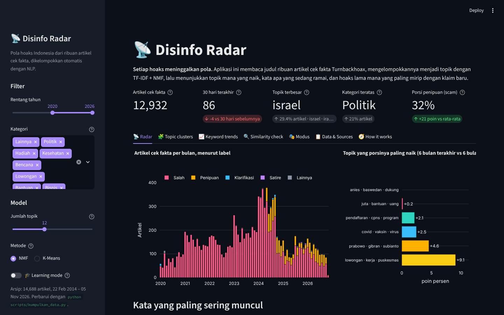
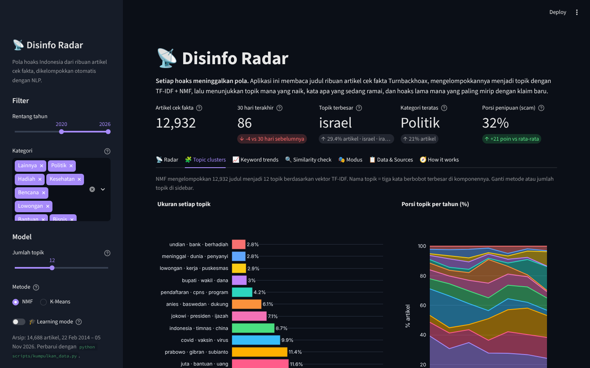
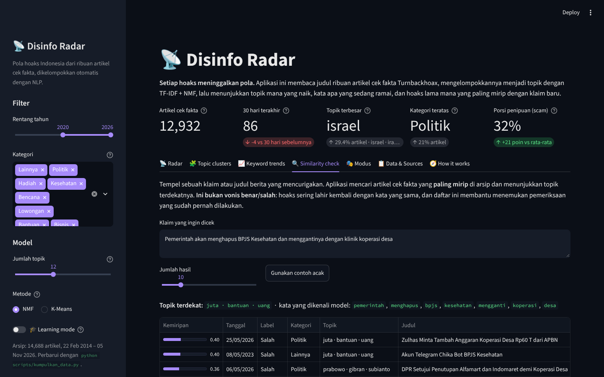
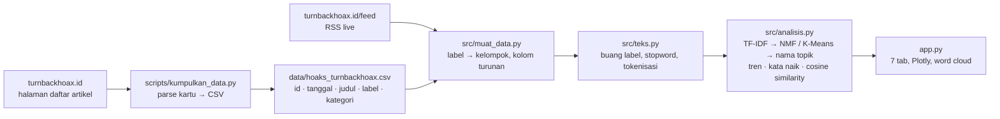

# 📡 Disinfo Radar

> Pola hoaks Indonesia dari **14.688 artikel cek fakta** Turnbackhoax (Mafindo), 2014–2026, dikelompokkan otomatis
> menjadi topik dengan TF-IDF + NMF: topik apa yang naik, kata apa yang sedang ramai, format hoaks yang berubah,
> dan hoaks lama mana yang paling mirip dengan klaim baru. Python, scikit-learn, Plotly, Streamlit.

*Every lie leaves a fingerprint. A radar for Indonesian disinformation, built on 14,688 public fact-check articles:
simple NLP (TF-IDF + NMF, with K-Means as a comparison) sorts the hoaxes into topics, tracks which topics and words are rising, shows how the
format shifts from chain messages to scam links, and finds the closest debunked claim for any new one. Python,
scikit-learn, Plotly and Streamlit.*

**🚀 Coba langsung di browser:** [hoax-radar.streamlit.app](https://hoax-radar.streamlit.app)



> ℹ️ **Disclaimer.** Seluruh data berasal dari **arsip publik** artikel cek fakta Turnbackhoax: judul, label, kategori,
> dan tanggal yang memang ditampilkan di halaman daftar artikelnya. Aplikasi ini mengelompokkan dan menghitung, bukan
> memutuskan benar atau salah; penilaian tetap milik pemeriksa fakta. Proyek edukatif dan portofolio pribadi, tidak
> berafiliasi dengan Mafindo atau instansi mana pun.

## Latar belakang

Setiap hari pemeriksa fakta Indonesia membantah puluhan klaim: tautan bansos palsu, video bencana yang salah tempat,
kutipan pejabat yang tidak pernah diucapkan. Satu per satu artikelnya mudah dibaca; ribuan artikel sekaligus tidak.
Pertanyaannya sederhana: **kalau semua judul itu dibaca mesin, pola apa yang muncul?** Topik apa yang mendominasi
tiap tahun, kapan hoaks vaksin digantikan hoaks pemilu, apakah "penipuan" benar-benar makin banyak, dan apakah klaim
yang viral hari ini sebenarnya hoaks lama yang didaur ulang?

Arsip Turnbackhoax memberi bahan untuk menjawabnya: setiap artikel punya label (`[SALAH]`, `[PENIPUAN]`,
`[KLARIFIKASI]`), kategori, dan tanggal. Proyek ini sekaligus menjadi latihan NLP dasar yang jujur: pembersihan teks
bahasa Indonesia, TF-IDF, klasterisasi tak terawasi, dan pencarian kemiripan, tanpa model besar dan tanpa API berbayar.

## Fitur

| Tab | Isi |
|---|---|
| 📡 Radar | Artikel per bulan menurut label, topik yang porsinya paling naik, word cloud + 20 kata teratas, dan **RSS live**: artikel terbaru Turnbackhoax langsung dipetakan ke topik terdekat |
| 🧩 Topic clusters | NMF atau K-Means (metode dan jumlah topik 4-24 diatur di sidebar): ukuran tiap topik, porsi topik per tahun, tabel kata kunci / kategori dominan / tahun puncak, telusuri satu topik dengan contoh judul |
| 📈 Keyword trends | Tren bulanan kata pilihan (vaksin, gempa, prabowo, bansos, ...) dan tabel **kata yang naik / mereda** N bulan terakhir vs sebelumnya, dihitung per 1.000 judul |
| 🔍 Similarity check | Tempel klaim apa pun: topik terdekat + daftar artikel cek fakta paling mirip (cosine similarity) beserta tautannya. Bukan vonis, melainkan pencarian pemeriksaan yang sudah ada |
| 🎭 Modus | Porsi label per tahun (lihat naiknya *Penipuan*), format unggahan yang disebut di judul (video / foto / tautan / pesan berantai), heatmap kategori × tahun, hari terbit |
| 📋 Data & Sources | Tabel yang bisa dicari, download CSV lengkap dengan nomor topik, sumber, dan keterbatasan |
| 🧭 How it works | Diagram alur data → teks → TF-IDF → NMF → grafik, dan konsep yang dipakai |
| 🎓 Learning mode | Toggle di sidebar: setiap tab menampilkan expander berisi rumus, potongan kode, dan alasan di balik keputusan desain |




## Cara menjalankan

```bash
git clone https://github.com/Avalon2222/disinfo-radar.git
cd disinfo-radar
python -m venv .venv && source .venv/bin/activate   # Windows: .venv\Scripts\activate
pip install -r requirements.txt
streamlit run app.py
```

Buka `http://localhost:8501`. Jalankan pengujian dengan `python -m pytest tests/ -v` (27 tes, tanpa internet).
Model TF-IDF + NMF dilatih saat aplikasi dibuka (beberapa detik) dan di-cache; mengubah filter atau jumlah topik
melatih ulang.

Memperbarui arsip:

```bash
python scripts/kumpulkan_data.py           # ambil artikel baru saja (beberapa halaman)
python scripts/kumpulkan_data.py --semua   # unduh ulang seluruh arsip (±45 menit, server Turnbackhoax lambat)
```

Workflow GitHub Actions `perbarui-data.yml` menjalankan mode pertama setiap minggu dan melakukan commit bila ada
artikel baru.

## Cara kerja (ringkas)



| Modul | Yang dilakukan |
|---|---|
| `scripts/kumpulkan_data.py` | Membaca halaman daftar artikel Turnbackhoax (10 kartu per halaman) dengan `requests` + regex: id, judul lengkap, ringkasan, kategori, tanggal. Mode perbarui hanya mengambil yang baru; mode `--semua` menyimpan hasil setiap blok agar bisa dilanjutkan |
| `src/muat_data.py` | Membaca CSV, menyatukan gaya label lintas tahun (`[SALAH]`, `(HOAX)`, `[DISINFORMASI]`, ...) ke enam kelompok, menambah kolom bulan / tahun / format, mengambil dan mengurai RSS |
| `src/teks.py` | Pembersihan judul: buang awalan label, URL, angka, tanda baca; stopword umum (±780 kata) + stopword domain cek fakta (±60 kata); tanpa stemming, dengan alasan yang dijelaskan di `docs/BELAJAR.md` |
| `src/analisis.py` | `TfidfVectorizer` (kata + pasangan kata, `min_df=3`, `max_df=0.5`) → `NMF` (bawaan) atau `KMeans` → nama topik dari komponen / pusat → tren bulanan, kata naik/turun (laju per 1.000 judul dengan pemulusan Laplace), cosine similarity untuk klaim baru |
| `app.py` | Sidebar (rentang tahun, kategori, k, learning mode) → model di-cache per filter → tujuh tab |

Definisi yang dipakai:

- **Topik** = komponen NMF (atau klaster K-Means); namanya tiga kata berbobot terbesar di komponennya. Mengubah k atau metode mengubah topik.
- **Label** = awalan judul yang diberikan Turnbackhoax, disatukan ke Salah / Penipuan / Klarifikasi / Benar / Satire / Lainnya.
- **Format** = tebakan dari kata di judul (video, foto, tautan, pesan berantai); heuristik, bukan data resmi.
- **Kata yang naik** = rasio laju per 1.000 judul sesudah vs sebelum tanggal batas, minimal 8 kemunculan total.

## Data

| Data | Sumber | Keterangan |
|---|---|---|
| Arsip artikel cek fakta | [Turnbackhoax](https://turnbackhoax.id) (Mafindo), halaman daftar artikel | `data/hoaks_turnbackhoax.csv`: 14.688 artikel, 2014–5 November 2026 (±975 kartu bertanggal mustahil dibuang). Hanya metadata (judul, label, kategori, tanggal, ringkasan singkat, URL) |
| Artikel terbaru | [turnbackhoax.id/feed](https://turnbackhoax.id/feed) | RSS resmi, diambil saat aplikasi dibuka, cache 30 menit |
| Stopword | `src/teks.py` | Disusun sendiri; lihat `data/SUMBER_DATA.md` |

Rincian, lisensi, dan keterbatasan setiap sumber ada di [`data/SUMBER_DATA.md`](data/SUMBER_DATA.md).

## Yang ditemukan (snapshot November 2026)

- **Penipuan menggantikan hoaks "biasa".** Label `[PENIPUAN]` baru dipakai Turnbackhoax sejak 2024, dan porsinya
  melonjak: 17% artikel pada 2024, 23% pada 2025, **35% pada 2026**. Kata yang menandainya: *tautan*, *pendaftaran*,
  *lowongan*, *bantuan*, *undian*. Format "tautan / situs" di judul naik dari 1-3% (2020-2024) menjadi 15% (2025) dan
  26% (2026), sementara "pesan berantai" nyaris hilang.
- **Topik mengikuti kalender politik dan krisis.** Dengan NMF 12 topik pada 2020-2026: konflik *Israel · Iran ·
  serangan* menjadi topik terbesar (29%), disusul *juta · bantuan · uang* (12%), *Prabowo · Gibran* (11%), *Covid ·
  vaksin* (10%, puncak 2021), *Jokowi · presiden · ijazah* (7%), *Anies · Baswedan* (6%, puncak 2023), serta
  *lowongan kerja* dan *pendaftaran CPNS* yang puncaknya justru 2026.
- **Kata yang naik 12 bulan terakhir** (dibanding periode sebelumnya, per 1.000 judul): *kopdes*, *karhutla*, *MBG*,
  *BGN*, *Purbaya*, *Hormuz*. Yang mereda: *Ganjar*, *Covid*, *corona*, *KPU*, *tangkapan layar*.
- **2024 adalah tahun tersibuk**: 3.459 artikel, hampir dua kali 2022. Artikel terbit terutama Senin-Jumat
  (±2.400 per hari kerja vs ±1.300 pada Sabtu/Minggu), petunjuk bahwa jumlah artikel mencerminkan ritme tim
  pemeriksa fakta, bukan hanya ritme hoaksnya.
- **K-Means vs NMF**: pada data yang sama, K-Means menumpuk ±70% judul di satu klaster; NMF menghasilkan topik
  terbesar ±30%. Perbandingannya bisa dicoba langsung lewat sidebar.

Angka berubah seiring arsip diperbarui; buka aplikasi untuk nilai terkini.

## Struktur repo

```
disinfo-radar/
├── app.py                        # UI Streamlit (sidebar, tab, grafik, word cloud)
├── src/
│   ├── teks.py                   # pembersihan teks, stopword, deteksi format
│   ├── analisis.py               # TF-IDF, K-Means, nama topik, tren, kata naik, kemiripan
│   └── muat_data.py              # arsip CSV, pengelompokan label, RSS
├── scripts/
│   ├── kumpulkan_data.py         # bangun / perbarui data/hoaks_turnbackhoax.csv
│   └── tangkap_layar.py          # screenshot untuk README (Playwright)
├── data/                         # hoaks_turnbackhoax.csv, SUMBER_DATA.md
├── docs/                         # BELAJAR.md, LATIHAN.md, screenshots/
├── tests/                        # pytest: teks, muat_data, analisis
├── .github/workflows/            # pembaruan arsip mingguan
└── requirements.txt
```

## Belajar dari proyek ini

- [`docs/BELAJAR.md`](docs/BELAJAR.md): penjelasan langkah demi langkah tentang pengambilan data, pembersihan teks
  bahasa Indonesia, TF-IDF, NMF dan K-Means, tren, cosine similarity, dan cara aplikasi ini disusun.
- [`docs/LATIHAN.md`](docs/LATIHAN.md): sembilan latihan bertingkat, dari mengganti warna sampai memperbaiki K-Means
  dengan LSA, mencoba stemming Sastrawi, sentence embedding, dan pendeteksi lonjakan otomatis.

## Rencana berikutnya

- Topik yang lebih bersih dengan BERTopic dan evaluasi *coherence*; pelabelan topik dengan LLM.
- Pencarian makna, bukan kata: sentence embedding multibahasa untuk tab Similarity check.
- Sumber kedua: artikel cek fakta Tempo, Kompas, dan Liputan6 dari feed ClaimReview (Google Fact Check Tools) agar
  tren tidak bergantung pada satu lembaga.
- Pendeteksi lonjakan otomatis per topik dan pengait ke peristiwa (pemilu, bencana, kebijakan).

## Lisensi

Kode: MIT. Data mengikuti ketentuan sumbernya (lihat `data/SUMBER_DATA.md`).
